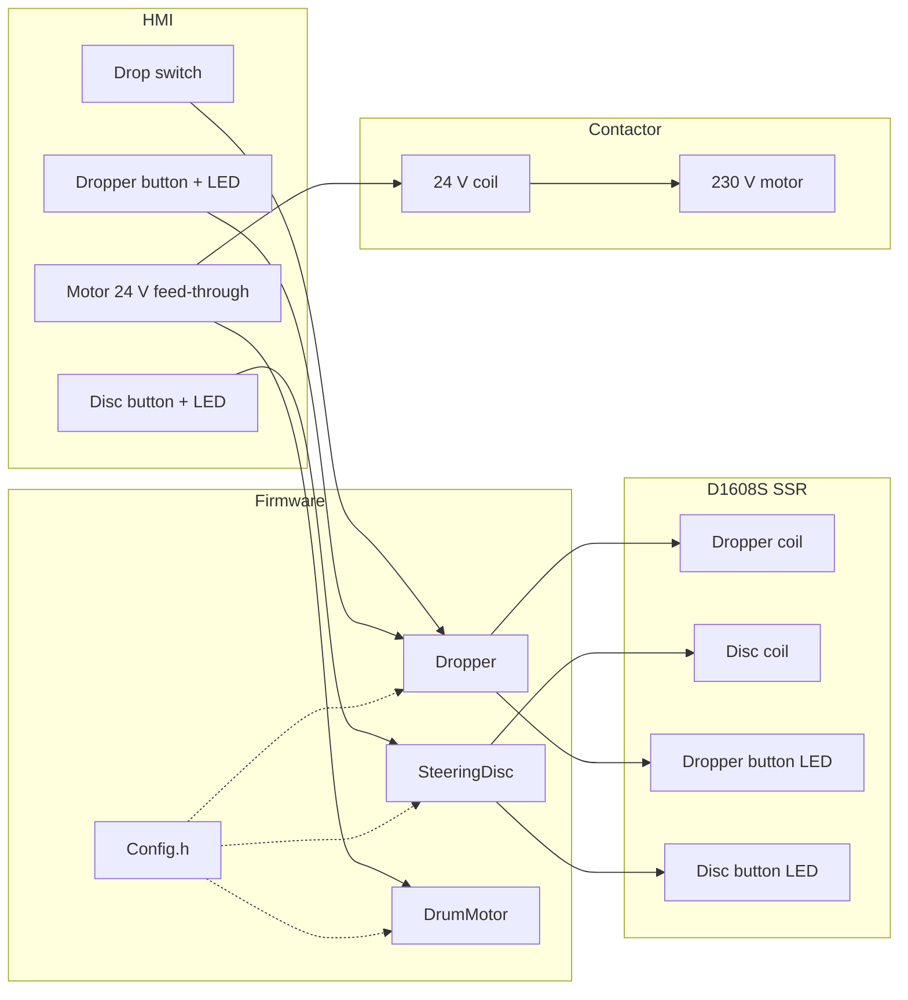

# Multidrop Test

**Preliminary** firmware for the Versive dropper and steering-disc stand.

Two single-solenoid valves on an Arduino **Opta** + **D1608S** solid-state expansion. The SSR applies 24 V directly to the coil.

[](https://docs.arduino.cc/hardware/opta/)
[](#)
[](#current-limits)

Two external 24 V illuminated buttons (drop, back test) start and stop the two pneumatic programs; either button's press stops both if one is running. Each button's own LED lights while that program runs. The dropper still follows a position switch while it is stopped. I7 reads the 24 V that already feeds the multidrum motor contactor.

> [!IMPORTANT]
> After every change: **Verify → Upload** to the Opta.  
> `Config.h` is compiled into the firmware: resetting the board does **not** apply the new values.

---

## Contents

- [Architecture](#architecture)
- [Hardware](#hardware)
- [Machine behavior](#machine-behavior)
- [Config.h](#configh)
- [Build and upload](#build-and-upload)
- [Current limits](#current-limits)

---

## Architecture

You almost only change **`Config.h`** (pins, SSR indices, timings).

```text
multidrop_test/
├── multidrop_test.ino    # setup / loop, Opta + expansion wiring
├── Config.h              # pins, SSR indices, timings
├── Dropper.h/.cpp        # M1 dropper valve, buttons, LEDs
├── SteeringDisc.h/.cpp   # M2 steering-disc valve, buttons, LEDs
├── DrumMotor.h/.cpp      # Multidrum motor: I7 reads the contactor 24 V
├── Button.h/.cpp         # External 24 V NO button, debounced press edge
└── README.md
```



| Module | Role |
|---|---|
| `multidrop_test.ino` | Composition root: Opta, expansion, `setup()`, `loop()` |
| `Config.h` | Constants (it is not a class) |
| `Dropper` | Start / stop, 1 s toggle, follow the position switch when stopped |
| `SteeringDisc` | Start / stop, 1 s toggle, valve off when stopped |
| `DrumMotor` | Reads I7: HIGH means 24 V is on the contactor coil |
| `Button` | Debounces one external 24 V NO button, reports the press edge once |

---

## Hardware

Board: **Arduino Opta** (`arduino:mbed_opta:opta`)  
Library: [Arduino_Opta_Blueprint](https://github.com/arduino-libraries/Arduino_Opta_Blueprint) (`OptaBlue.h`)  
Expansion: first **D1608S** solid-state module → `OptaController.getExpansion(0)`

Software SSR indices: **0 = first relay** of the expansion.

| Function | Pin / SSR | Notes |
|---|---|---|
| Dropper valve | SSR 0 (O1) | 24 V on the coil when the output is HIGH |
| Steering disc valve | SSR 1 (O2) | 24 V on the coil when the output is HIGH |
| Dropper button LED | SSR 2 (O3) | lit (HIGH) while the dropper runs |
| Disc button LED | SSR 3 (O4) | lit (HIGH) while back test runs |
| Drop position switch | `A0` (I1) | HIGH = bottom, LOW = top |
| Dropper button | `A1` (I2) | external 24 V illuminated NO button, HIGH when pressed |
| Disc button | `A2` (I3) | external 24 V illuminated NO button, HIGH when pressed |
| Motor 24 V | `A6` (I7) | Parallel feed-through: same 24 V as the contactor coil |

Each button is a TRU-style illuminated NO pushbutton with a built-in 12 V
red/green LED. Only the green leg is used. On the panel each button already
has its own 380 Ω resistor in series toward +24 V, dropping the LED to its
~12 V rating.

Wiring a button's LED is the same pattern as a valve coil, just switching a
lamp instead of a solenoid:

```text
+24 V ──> [D1608S SSR output, O3 or O4] ──> 380 Ω resistor ──> LED (green leg, + ) ──> 0 V / COM
```

The SSR channel is a plain isolated contact (like a relay), in series with
the loop — polarity only matters at the LED itself (current must flow from
its anode to its cathode). The button's unused red leg stays disconnected.
Return (0 V/COM) is the same rail already used by the two valve coils.

On each valve:

| State | SSR |
|---|---|
| solenoid on | HIGH, 24 V on the coil |
| solenoid off | LOW, coil off |

The old Arduino Uno pins, the Finder 5 V → 24 V sockets, and the on-board
USER button / Opta LEDs are not used.

---

## Machine behavior

The two valves are independent of the motor. The Opta does not switch the contactor.

### Buttons

Each button is debounced (`BUTTON_DEBOUNCE_MS`) and reports a single press
on the rising edge (24 V = pressed).

| Button | Idle | A pneumatic program running |
|---|---|---|
| Dropper | start dropper (LED on) | stop dropper and back test (both LEDs off) |
| Back test | start back test (LED on) | stop dropper and back test (both LEDs off) |

Either button stops both programs first if one is already running — a
button never starts a second program on top of a running one.

### Multidrum motor

Two feed-through terminals are tied together. One feeds 24 V DC to the contactor coil (the contactor closes 230 V AC to the motor). The other goes to Opta **I7**.

- **I7 HIGH:** 24 V is on the coil.
- **I7 LOW:** coil off.
- No SSR. The firmware only reads the signal.
- Drum revolutions are counted from I7 on-time at 75 rpm (1500 U/min ÷ 20). No encoder.
- Cylinder diameter 250 mm → ≈ 0.785 m per revolution.
- USB serial (115200) prints wheelchair-drum **rotations** and **km** every second while I7 is HIGH.
- I7 LOW prints the totals, then resets to 0. The next motor-on starts from zero.

### Dropper

- **Start:** solenoid on, then on/off every `DROPPER_INTERVAL_MS` (500 ms).
- **Running:** the SSR flips every `DROPPER_INTERVAL_MS`. HIGH is the bottom command.
- **Stop:** commands the bottom position, then follows the position switch.
- **Stopped:** if the switch changes, the valve follows it. HIGH on I1 means bottom.

### Steering disc

- **Start:** solenoid on, then on/off every `DISC_INTERVAL_MS` (500 ms).
- **Stop:** valve off.

The main loop waits `LOOP_DELAY_MS` (20 ms) between passes. Each button has its own debounce (`BUTTON_DEBOUNCE_MS`).

---

## Config.h

`Config` is a **namespace** of constants, not an object. Use it like this: `Config::Pins::DROPPER_SSR`.

### Pins

```cpp
namespace Pins {
    constexpr int DROP_SWITCH    = A0;  // I1
    constexpr int DROPPER_BUTTON = A1;  // I2
    constexpr int DISC_BUTTON    = A2;  // I3
    constexpr int MOTOR_SWITCH   = A6;  // I7
    constexpr int DROPPER_SSR     = 0;  // O1
    constexpr int DISC_SSR        = 1;  // O2
    constexpr int DROPPER_LED_SSR = 2;  // O3
    constexpr int DISC_LED_SSR    = 3;  // O4
}
```

### Timings

| Constant | Default | Use |
|---|---|---|
| `DROPPER_INTERVAL_MS` | 1000 | dropper on/off half-period |
| `DISC_INTERVAL_MS` | 1000 | back-test on/off half-period |
| `LOOP_DELAY_MS` | 20 | pause at the end of `loop()` |
| `BUTTON_DEBOUNCE_MS` | 40 | debounce for both external buttons |

`USE_POT` is `false`. The steering-disc interval stays fixed. A5 (I6) is reserved if the potentiometer is enabled later.

### Motor kinematics

| Constant | Default | Use |
|---|---|---|
| `Motor::RPM` | 1500 | motor shaft |
| `Motor::GEAR_RATIO` | 20 | 20:1 gearbox |
| `Motor::DRUM_DIAMETER_MM` | 250 | cylinder |
| `Motor::DRUM_RPM` | 75 | cylinder = RPM / GEAR_RATIO |
| `Timing::MOTOR_REPORT_MS` | 1000 | serial print interval |

---

## Build and upload

**Arduino IDE 2**

1. Open the `multidrop_test` sketch folder (the `.ino` must have the same name as the folder)
2. Board: **Arduino Opta**
3. Install the **Arduino_Opta_Blueprint** library
4. Opta port → **Upload**

**arduino-cli**

```bash
arduino-cli compile --fqbn arduino:mbed_opta:opta --clean
arduino-cli upload  --fqbn arduino:mbed_opta:opta -p /dev/cu.usbmodem1101
```

On macOS the port is often `/dev/cu.usbmodem*`.

---

## Current limits

It works as a **preliminary test**. Not yet present:

- [ ] Potentiometer interval (`USE_POT` is off)
