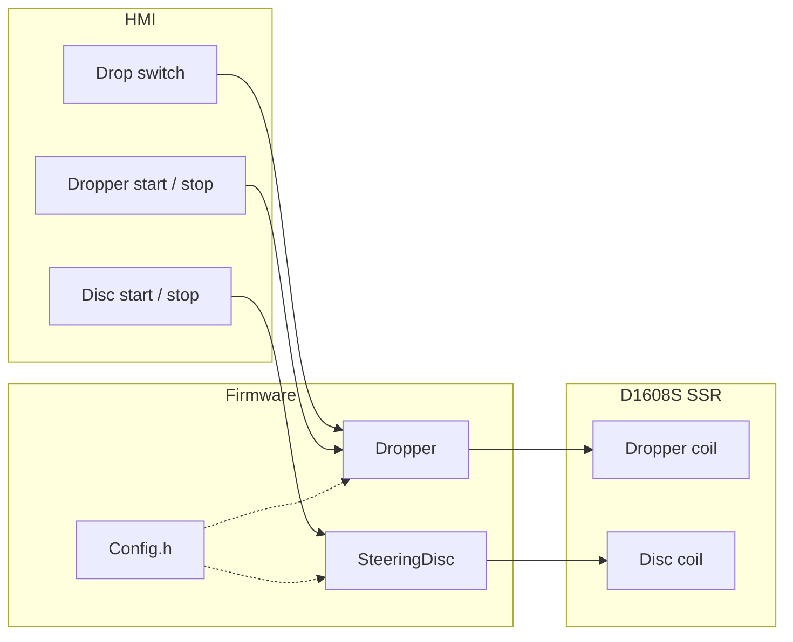

# Multidrop Test

**Preliminary** firmware for the Versive dropper and steering-disc stand.

Two single-solenoid valves on an Arduino **Opta** + **D1608S** solid-state expansion. The SSR applies 24 V directly to the coil.

[](https://docs.arduino.cc/hardware/opta/)
[](#)
[](#current-limits)

Each machine has its own start and stop button. The dropper also follows a position switch while it is stopped.

> [!IMPORTANT]
> After every change: **Verify → Upload** to the Opta.  
> `Config.h` is compiled into the firmware: resetting the board does **not** apply the new values.

---

## Contents

- [Architecture](#architecture)
- [Hardware](#hardware)
- [Machine behavior](#machine-behavior)
- [Config.h](#configh)
- [Build and upload](#build-and-upload)
- [Current limits](#current-limits)

---

## Architecture

You almost only change **`Config.h`** (pins, SSR indices, timings).

```text
multidrop_test/
├── multidrop_test.ino    # setup / loop, Opta + expansion wiring
├── Config.h              # pins, SSR indices, timings
├── Dropper.h/.cpp        # M1 dropper valve, buttons, LEDs
├── SteeringDisc.h/.cpp   # M2 steering-disc valve, buttons, LEDs
└── README.md
```



| Module | Role |
|---|---|
| `multidrop_test.ino` | Composition root: Opta, expansion, `setup()`, `loop()` |
| `Config.h` | Constants (it is not a class) |
| `Dropper` | Start / stop, 2.5 s toggle, follow the position switch when stopped |
| `SteeringDisc` | Start / stop, 2 s toggle, valve off when stopped |

---

## Hardware

Board: **Arduino Opta** (`arduino:mbed_opta:opta`)  
Library: [Arduino_Opta_Blueprint](https://github.com/arduino-libraries/Arduino_Opta_Blueprint) (`OptaBlue.h`)  
Expansion: first **D1608S** solid-state module → `OptaController.getExpansion(0)`

Software SSR indices: **0 = first relay** of the expansion.

| Function | Pin / SSR | Notes |
|---|---|---|
| Dropper valve | SSR 0 | 24 V on the coil when the output is HIGH |
| Steering disc valve | SSR 1 | 24 V on the coil when the output is HIGH |
| Drop position switch | `A0` (I1) | HIGH = bottom, LOW = top |
| Dropper start | `A1` (I2) | 24 V when pressed |
| Dropper stop | `A2` (I3) | 24 V when pressed |
| Disc start | `A3` (I4) | 24 V when pressed |
| Disc stop | `A4` (I5) | 24 V when pressed |
| Dropper green / red | `LED_D0` / `LED_D1` | on-board Opta LEDs |
| Disc green / red | `LED_D2` / `LED_D3` | on-board Opta LEDs |

Green is on while that machine runs. Red is on while it is stopped.

On each valve:

| State | SSR |
|---|---|
| solenoid on | HIGH, 24 V on the coil |
| solenoid off | LOW, coil off |

The old Arduino Uno pins and the Finder 5 V → 24 V sockets are not used.

---

## Machine behavior

The two machines are independent. Pressing start or stop on one does not change the other.

### Dropper

- **Start:** begins the 2.5 s toggle from the current valve state.
- **Running:** the SSR flips every `DROPPER_INTERVAL_MS`. HIGH is the bottom command.
- **Stop:** commands the bottom position, then follows the position switch.
- **Stopped:** if the switch changes, the valve follows it. HIGH on I1 means bottom.

### Steering disc

- **Start:** forces the valve off, then flips every `DISC_INTERVAL_MS`.
- **Stop:** valve off.

The main loop waits `LOOP_DELAY_MS` (20 ms) between passes. That pause is the only button filtering.

---

## Config.h

`Config` is a **namespace** of constants, not an object. Use it like this: `Config::Pins::DROPPER_SSR`.

### Pins

```cpp
namespace Pins {
    constexpr int DROP_SWITCH   = A0;  // I1
    constexpr int DROPPER_START = A1;  // I2
    constexpr int DROPPER_STOP  = A2;  // I3
    constexpr int DISC_START    = A3;  // I4
    constexpr int DISC_STOP     = A4;  // I5
    constexpr int DROPPER_GREEN = LED_D0;
    constexpr int DROPPER_RED   = LED_D1;
    constexpr int DISC_GREEN    = LED_D2;
    constexpr int DISC_RED      = LED_D3;
    constexpr int DROPPER_SSR   = 0;
    constexpr int DISC_SSR      = 1;
}
```

### Timings

| Constant | Default | Use |
|---|---|---|
| `DROPPER_INTERVAL_MS` | 2500 | dropper toggle |
| `DISC_INTERVAL_MS` | 2000 | steering-disc toggle |
| `LOOP_DELAY_MS` | 20 | pause at the end of `loop()` |

`USE_POT` is `false`. The steering-disc interval stays fixed. A5 (I6) is reserved if the potentiometer is enabled later.

---

## Build and upload

**Arduino IDE 2**

1. Open the `multidrop_test` sketch folder (the `.ino` must have the same name as the folder)
2. Board: **Arduino Opta**
3. Install the **Arduino_Opta_Blueprint** library
4. Opta port → **Upload**

**arduino-cli**

```bash
arduino-cli compile --fqbn arduino:mbed_opta:opta --clean
arduino-cli upload  --fqbn arduino:mbed_opta:opta -p /dev/cu.usbmodem1101
```

On macOS the port is often `/dev/cu.usbmodem*`.

---

## Current limits

It works as a **preliminary test**. Not yet present:

- [ ] 5 V LED buttons. Opta digital inputs turn on at 6.6 V, so a 5 V contact does not read as HIGH
- [ ] Potentiometer interval (`USE_POT` is off)
- [ ] Debounce beyond the 20 ms loop pause
